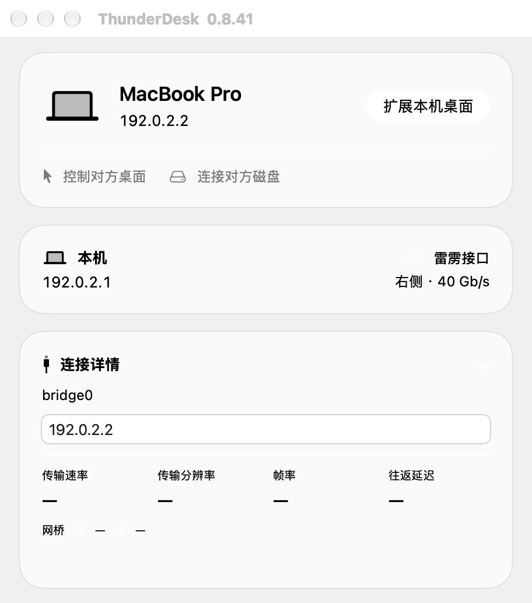
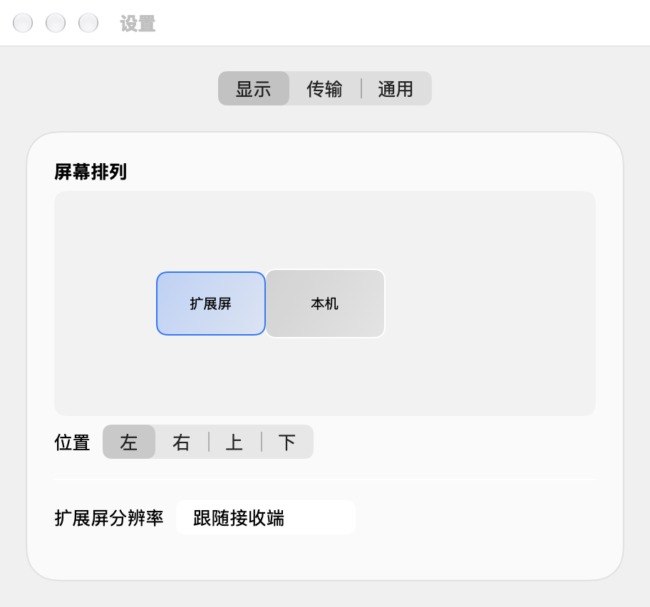

# ThunderDesk

把另一台 Mac 用作有线扩展屏。通过雷雳网桥连接后，把本机窗口拖过屏幕边缘，就能在另一台 Mac 上继续使用。本机运行应用和处理文件，接收端负责显示画面，也可以使用自己的键盘和鼠标操作扩展桌面。

[下载最新 Apple Silicon 安装包](https://github.com/cevnlau/ThunderDesk/releases/latest) · [查看各版本更新说明和历史下载](CHANGELOG.md)

## App 展示

| 设备与连接 | 屏幕排列 |
| --- | --- |
|  |  |

图中设备和地址为演示数据。连接后可查看实际视频速率、传输分辨率、帧率及往返延迟。帧率随画面变化、两台设备性能和当前传输模式变化；接口标称速率与视频实时速率分别显示。

## 安装和第一次扩展

1. 两台 Apple Silicon Mac 均使用 macOS 13 或以上版本。下载 ZIP，解压后把 ThunderDesk.app 放入两台 Mac 的「应用程序」，分别打开。
2. 用支持雷雳数据传输的线缆连接两台 Mac。应用自动搜索网桥和接收端。接收端就绪后，在主机点击「扩展本机桌面」。
3. 主机按 macOS 提示授予录屏权限。需要用接收端键鼠操作时，在主机授权 ThunderDesk Helper 的辅助功能权限。
4. 在「设置 → 显示」将扩展屏拖到桌面的左、右、上或下方。将本机窗口拖过对应边缘即可。完成后可在主窗口停止扩展。

## 传输和设备操作

- 「无压缩直传」适合在有线连接上传输原始画面；关闭后可使用 HEVC。分辨率可跟随接收端，也可手动选择。
- 支持协商最高 120 Hz。HDR 采集需要 macOS 15 或以上和兼容显示设备。连接详情中的往返延迟为控制消息测量值。
- 「控制对方桌面」会打开 macOS 系统屏幕共享，访问对方原有桌面。目标机须允许屏幕共享。
- 「连接对方磁盘」通过访达访问目标 Mac 已通过文件共享开放的卷或文件夹。按系统提示选择账户及共享卷。

## 版本更新

从 0.8.41 起，在「设置 → 通用」可手动检查更新或关闭每日自动检查。发现新版时，弹窗显示发行说明，并提供「稍后更新」和「立即更新」。立即更新会下载更新包，校验主应用和 Helper 的签名，安装后重新打开。普通用户下载和检查公开版本均无需 GitHub 登录。

发行页提供 ZIP 用于手动安装，.tdupdate 用于应用内更新。历史安装包及其 SHA-256 校验清单见 [历史归档](history/)。
